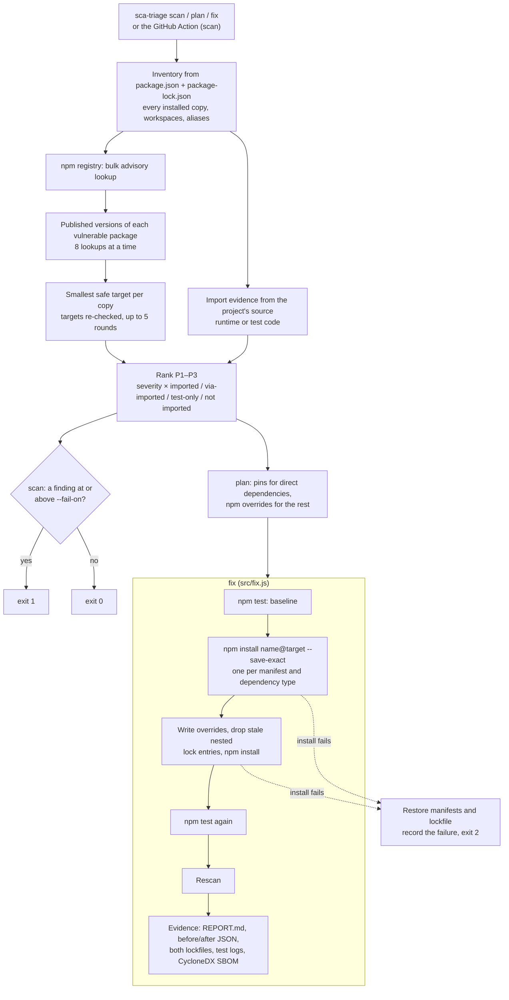

# Architecture

sca-triage is a command-line tool and GitHub Action for npm projects. `scan` reads `package.json` and `package-lock.json` (v2 or v3), asks the npm registry which locked versions have known advisories (the GitHub Advisory Database, the same data `npm audit` uses), checks whether the project's own code loads each vulnerable package, and ranks the findings P1–P3. `plan` shows the smallest safe upgrade for each finding; `fix` applies them, runs the project's tests, rescans and writes an evidence folder. It has no dependencies of its own, only Node.js 20+ built-ins. Untrusted-input handling is summarized in [SECURITY.md](SECURITY.md).

## Components

| File | Responsibility |
|---|---|
| `bin/sca-triage.js` | CLI: parses `scan`, `plan` and `fix` and their options, rejects an unknown option or a second directory (exit 2), prints results and maps them to exit codes. |
| `src/lockfile.js` | Reads `package.json` and `package-lock.json` (v1 is rejected). Lists every installed copy with its path, version, alias, owning workspace, dev and optional flags and the package that bundles it, if any; which packages require it and with what spec; and which direct dependencies lead to it. |
| `src/advisories.js` | Registry client: the bulk advisory endpoint (`/-/npm/v1/security/advisories/bulk`) and abbreviated package metadata for published versions. Each request has a 30 s timeout; network errors, timeouts, 429 and 5xx get up to 3 attempts, honouring `Retry-After` (capped at 10 s). Validates `SCA_TRIAGE_REGISTRY` and rejects malformed responses. |
| `src/reachability.js` | Finds which packages the project's own code loads: `require()`, `import`, `export … from`, dynamic `import()` and `createRequire()` in JavaScript, TypeScript, JSX/TSX, Vue, Svelte and Astro files and extensionless Node scripts. Separates runtime from test code. |
| `src/semver.js` | Version parsing and comparison, advisory ranges (`satisfies`) and npm dependency specs such as `^`, `~` and x-ranges (`acceptsVersion`). |
| `src/triage.js` | Turns the inventory, advisories and import evidence into findings: reachability level, P1–P3 and the smallest safe target for each copy. |
| `src/fix.js` | `plan` and `fix`: plans pins and overrides, runs npm, tests, rescans, writes the evidence folder and rolls back a failed install. |
| `src/report.js` | Console output, the Markdown findings table and `REPORT.md`; escapes untrusted names and paths. |
| `action.yml` | Composite GitHub Action: runs `scan` with `--fail-on` (default `P1`) and adds the Markdown table to the job summary. |

## Commands

| | `scan` | `plan` | `fix` |
|---|---|---|---|
| Reads | Manifests, lockfile, source | Same | Same |
| Network | npm registry | npm registry | npm registry and npm installs |
| Writes | Only `--markdown <file>` | Nothing | `package.json` files, `package-lock.json`, `node_modules`, evidence folder |
| Runs project code | No | No | `npm test` before and after, unless `--no-tests` or there is no `test` script |
| Exit codes | 0 below `--fail-on`, 1 at or above, 2 error | 0, or 2 on error | 0 tests pass or unverified, 1 tests fail after the upgrade, 2 error or failed install |

The GitHub Action runs `scan` only.

## Ranking

Each copy gets a reachability level: `imported` (runtime code requires the copy it resolves to), `via-imported` (an imported direct dependency leads to it), `test-only` or `not-imported`. Priority combines that with the highest advisory severity:

| | Imported or via an imported dependency | Test-only or not imported |
|---|---|---|
| Critical or high | P1 | P2 |
| Moderate | P2 | P3 |
| Low | P3 | P3 |

Reachability only lowers priority; every vulnerable copy is still reported.

## Upgrade planning

- **Target.** The smallest published, non-prerelease version above the installed one that no known advisory covers, on the same release line when one exists (same major, or same `0.minor` below 1.0.0). A target on another line is flagged as a major upgrade.
- **Re-checks.** The registry only returns advisories for the versions it is asked about, so each new candidate target is looked up too: one batched request per round, up to 5 rounds, picking again until no target changes. A target still unconfirmed after 5 rounds is kept with a warning.
- **Direct dependencies** are pinned with `npm install name@target --save-exact`, grouped into one install per manifest (root or workspace) and dependency type.
- **Other copies** get npm `overrides`: one global entry when every installed copy is in the plan, wants the same target and none is a direct dependency; otherwise entries scoped to the packages that require each copy. A package whose range excludes a pinned target (for example `express` requiring `body-parser` 1.18.3) gets a scoped override too.
- **Stale copies.** npm keeps a locked nested copy that an override rejects and lists it as invalid. Before the overrides install, `fix` removes the lock entries of every nested copy an override covers that is not at the override's version, so npm resolves them again.
- **Bundled copies** ship inside the tarball of the package above them, which npm overrides cannot change. They get no pin or override; `scan` shows "bundled in <package>: upgrade <package>", and `plan` and `fix` list them grouped by that package. A copy bundled by the project itself is fixed normally.
- **Scope.** All priorities are planned unless `--min-priority` narrows it.

## Trust boundaries

- **The scanned project is untrusted input.** Manifests, lockfile and source are parsed as data. `scan` and `plan` never install or run anything from it.
- **`fix` runs the project's own tests.** `npm test` runs project and dependency code with the user's permissions, so use `fix` only on projects whose tests you trust. Installs use `--ignore-scripts`, so dependency lifecycle scripts do not run.
- **The registry is untrusted.** `https://` only (`http://` only for `localhost`, `127.0.0.1` or `[::1]`), no credentials in `SCA_TRIAGE_REGISTRY`, and every response is shape-checked.
- **npm** is the only program `fix` starts. Every argument must match a plain package name, version, path or flag pattern, so a crafted package name cannot add a flag or, with Windows' shell, a command.

## Failure handling

- **Fail closed.** A registry error after retries, or a response that is not the documented shape, stops the command with exit code 2; it never becomes "no advisories". An advisory range the tool cannot parse counts as vulnerable, with a warning. Import detection leans toward "loaded" when unsure, since a missed import would hide a reachable vulnerability below the gate.
- **Rollback.** If an install step, or anything else before the post-upgrade tests, fails, `fix` restores `package.json`, every workspace manifest a pin targeted and `package-lock.json`, records the failed command in `REPORT.md` and exits 2. `node_modules` is not restored; run `npm ci`.
- **Failing tests** after a clean upgrade keep the changes and exit 1, with both test logs in the evidence folder. If the tests also failed before the upgrade, the output says so.
- **Unverified upgrades.** With `--no-tests` or no `test` script, changes are applied and marked unverified in the output and `REPORT.md`.

## Security controls

- No third-party dependencies; Node.js built-ins only.
- npm calls go through an argument allowlist, installs use `--ignore-scripts`, and npm's fund, audit and update-notifier messages are turned off.
- Source scanning: files under 2 MB, `node_modules` and `.git` skipped everywhere and build output folders at the project root, symlinks followed only inside the project, and bounded import patterns so a crafted file cannot cause catastrophic backtracking.
- Output: untrusted names and paths are escaped in Markdown, and terminal control characters are replaced in console output.
- Evidence: `REPORT.md`, `before.json` and `after.json`, both lockfiles, both test logs and a CycloneDX SBOM from `npm sbom`.

## Out of scope

- Package managers other than npm, and `package-lock.json` v1.
- Proving exploitability: reachability is import-level, with no call graph.
- Upgrading the packages that bundle vulnerable copies; `plan` names them, and the upgrade is manual.
- Vulnerabilities missing from the GitHub Advisory Database; results reflect the database at scan time, and zero findings is not a certification.
- Source-code flaws (see [sast-triage](https://github.com/lansiquo/sast-triage)), secrets and infrastructure code.
